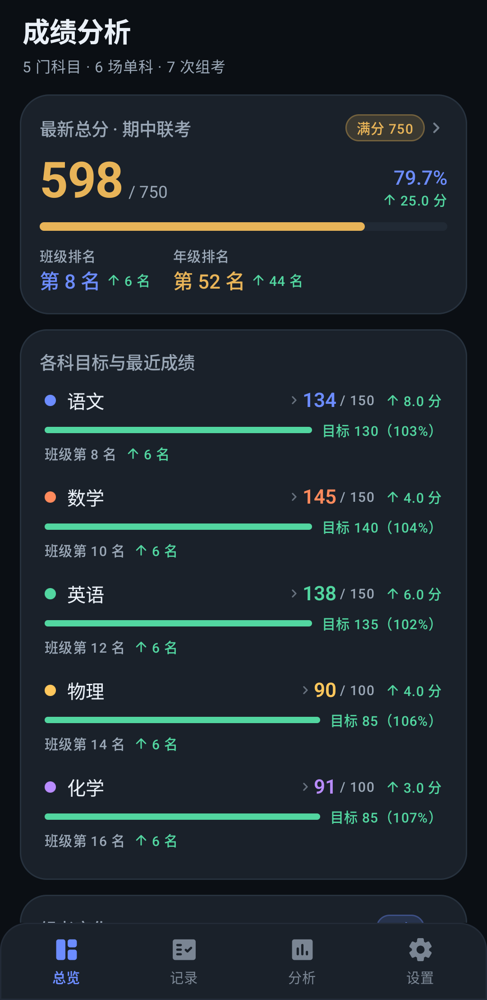
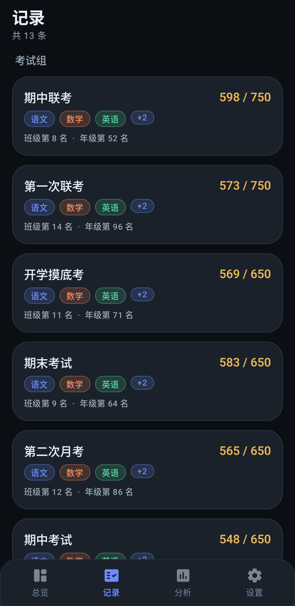
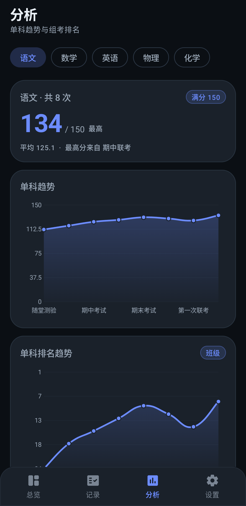
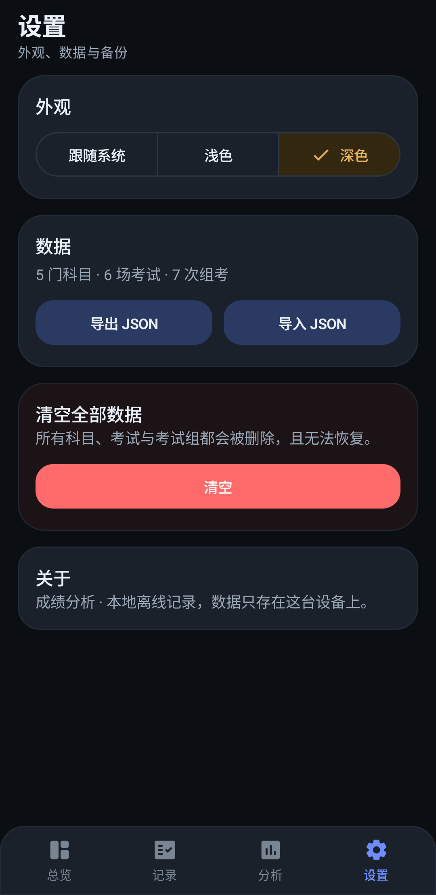
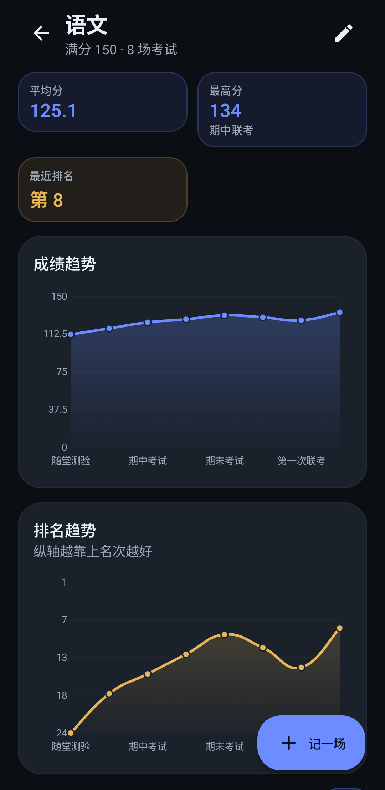
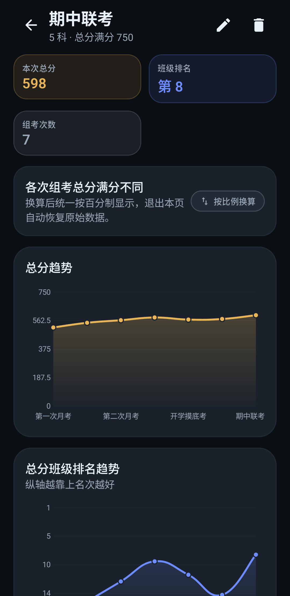

# 成绩分析（ScoreAnalysis）

离线安卓成绩记录与分析 App。Kotlin + Jetpack Compose 实现，图表全部用 Canvas 自绘，不联网、无账号、无埋点，数据只存在设备本地。

<p align="center">
  
  
  
</p>
<p align="center">
  
  
  
</p>

## 功能

### 总览
- 最新一次组考总分大号展示，配进度条与百分比，旁边标出与上一次相比的分数变化
- 班级排名、年级排名并排显示，各自带名次升降提示
- 各科目标与最近成绩：每科一行，显示最近得分、距上次的分数变化、目标达成率进度条（达标转绿）与班级排名变化，点击整行进入科目详情
- 组考变化：列出最近数次组考的分数差与名次变化
- 科目总览迷你趋势图

### 记录
- 考试组卡片：组名、总分、参与科目标签、班级与年级排名
- 单科考试列表，含考试组派生出来的成绩（带「考试组」标签，点击回到对应考试组修改）

### 分析
- 顶部科目胶囊切换，单科最高分大号展示并给出平均分与最高分来源
- 单科成绩趋势折线图、单科班级排名趋势折线图（纵轴反向，1 名在上）
- 组考总分、班级排名、年级排名三条对比曲线

### 科目详情
- 平均分、最高分（含来源场次）、最近排名三项 KPI
- 成绩趋势折线图、排名趋势折线图
- 考试记录列表，支持新增、修改、删除

### 考试组详情
- 本次总分、班级排名、组考次数
- 总分趋势折线图、总分班级排名趋势折线图、各科排名多折线图（点图例可只看某一科）

### 图表交互
- 折线图按 Catmull-Rom 平滑，进入页面时有描线动画
- 点击数据点弹出浮窗，显示名称、数值与排名；再点同一点或点空白处收起
- 同一页面所有图表共享浮窗状态，只允许一个图表同时显示浮窗
- 横拖可跟随显示数据点，纵滑交给外层列表滚动

### 按比例换算
- 当某科目存在「本场满分 ≠ 科目满分」，或各次组考总分满分不一致时，图表卡片旁出现「按比例换算」按钮
- 单科图表按 `score / examFullScore × subjectFullScore` 统一到科目满分基准
- 组考图表按 `total / totalFullScore × 100` 统一为百分制
- 换算状态只存在于界面内存，不写入磁盘，退出页面再进入自动恢复原始数据
- 排名是相对量，不受换算影响

### 录入与编辑
- 科目：名称、该科满分、目标分（可选）
- 单科考试：考试名称、日期、成绩、排名、本场满分（默认带出科目满分，可改）、备注
- 考试组：组名、日期、总分满分、班级与年级排名；勾选参与科目后逐科填成绩、排名与该科本场满分
- 录入考试组时，顶部粘性条实时显示累加总分与录入进度
- 缺考科目不计入总分，界面显式标注

### 数据与隐私
- 全部数据保存在应用私有目录 `files/app_data.json`，不申请网络权限
- 写入采用临时文件 + rename 原子替换，并保留 `app_data.json.bak`
- 读取损坏时自动回退备份，再失败则以空数据启动，不崩溃
- 设置页支持导出 / 导入 JSON（走系统文件选择器），导入时校验数据版本
- 支持清空全部数据

### 版本更新
- 启动时自动检查 GitHub Releases，发现比当前版本更高的版本时弹出更新说明（即该 release 的正文）
- 更新说明里可直接「下载更新」，下载完成自动拉起系统安装器；也可点「查看页面」在浏览器打开 release
- 首次启动检查失败不打扰使用，只在设置页手动检查时才提示失败原因
- 下载优先走国内镜像（ghfast.top / gh-proxy.com / ghproxy.net / mirror.ghproxy.com），全部不可用时回退官方地址
- 下载后会校验文件大小与 ZIP 头，避免把错误页面当成安装包
- 设置页显示当前版本号，并提供「检查更新」按钮

### 外观与适配
- 深色为默认主题，可切换浅色或跟随系统
- 深色下为近黑背景、卡片细描边、大圆角，主强调蓝紫、次强调金
- KPI 行自适应，窄屏两列换行
- 图表高度按屏幕自适应，横屏、竖屏、平板各自取值
- 平板与横屏内容宽度限制并居中
- 应用图标为纯矢量绘制，支持 Android 13 主题图标

## 工程结构

```
app/src/main/java/com/yg/scoreanalysis/
  MainActivity.kt            入口与导入导出
  App.kt                     路由、转场动画、底部导航
  data/Model.kt              数据模型（kotlinx.serialization）
  data/LocalStore.kt         原子读写与备份
  data/ScoreRepository.kt    唯一数据源（StateFlow）
  data/Aggregates.kt         最高分、分布、排名、派生考试等纯函数聚合
  data/Normalizer.kt         比例换算
  ui/theme/                  色板、大圆角 Shapes、字体、深色模式
  ui/chart/                  折线图、柱状图、多折线图、浮窗状态与尺寸策略
  ui/components/             圆角卡片、KPI、胶囊、换算开关
  ui/screens/                总览 / 记录 / 分析 / 科目 / 考试组 / 设置
app/src/test/java/...        ScoreLogicTest 单元测试
```

## 技术栈

Kotlin 2.0.21 · AGP 8.9.1 · Gradle 8.13 · Compose BOM 2024.10.01 · compileSdk 35 · minSdk 24

## 说明

- 排名需手动填写，跨校排名无法从本机数据推算
- 删除科目会同时删除其单科考试；考试组中的历史条目保留快照，科目名照旧显示
- 截图中的数据均为演示用虚构数据

## 许可证

[MIT](LICENSE)
